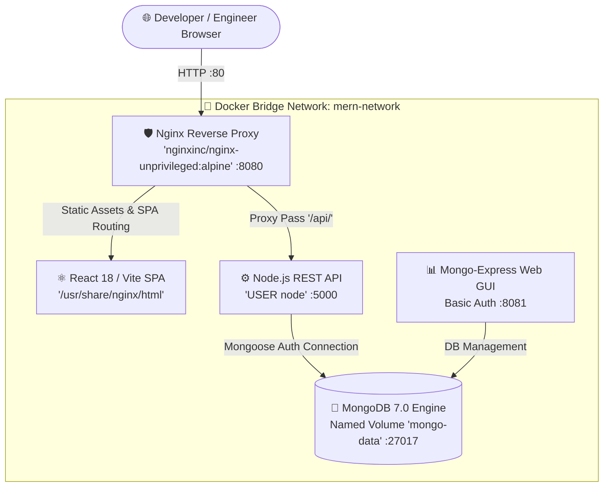

# ⚡ PromptVerse — AI Prompt Engineering & Community Hub

[](https://www.docker.com/)
[](https://nodejs.org/)
[](https://react.dev/)
[](https://nginx.org/)
[](https://www.mongodb.com/)
[](LICENSE)

A production-grade, containerized full-stack **AI Prompt Engineering & Community Repository**. PromptVerse allows engineers, developers, and creators to discover, publish, test, and copy battle-tested prompts across multiple LLM ecosystems (ChatGPT, Claude, Gemini, Midjourney). It features role-based access control (RBAC), multi-category filtering, 1-click clipboard integration, copy-tracking metrics, and a dedicated **in-app Prompt Engineering User Guide (in English)**.

---

## 🏛️ System Architecture

PromptVerse runs across an isolated Docker bridge network using hardened non-root container configurations and an Nginx reverse proxy.



---

## 🚀 Key Features

- **🔍 Curated Community Prompts**: Explore production-ready prompts categorized under DevOps & Cloud, Software Development, System Architecture, AI Art & Midjourney, and Data Analytics.
- **🤖 Target Model Badging**: Visual tags for target models (ChatGPT, Claude 3.5 Sonnet, Gemini, Midjourney).
- **📋 1-Click Clipboard Copying**: Instant prompt copy with real-time feedback and server-side copy usage tracking.
- **📝 Personal Studio (`/my-prompts`)**: Create, edit, and manage your custom prompts with variable placeholders like `[SERVICE_NAME]` or `[LANGUAGE]`.
- **📖 Comprehensive User Guide (`/guide`)**: Complete in-app English handbook explaining the 4-Pillar Prompt Framework (Role, Context, Instructions, Output), variable templates, and model-specific cheat sheets.
- **🛡️ Admin Moderation Console (`/admin`)**: Moderate community prompts, manage featured templates, and review IAM accounts.
- **🐳 Hardened Non-Root Security**:
  - Frontend: `nginxinc/nginx-unprivileged:alpine` (listening on port 8080, mapped to host 80).
  - Backend: `node:20-alpine` running as unprivileged `USER node` on port 5000.
  - Reverse Proxy: Solves CORS issues completely by proxying `/api/*` to the backend container.

---

## 🛠️ Quickstart (Docker Compose)

### 1. Configure Environment Variables
Copy `.env.example` to `.env`:
```bash
cp .env.example .env
```

### 2. Run with Docker Compose
```bash
docker compose up -d --build
```

### 3. Access Services
- 🌐 **PromptVerse Application**: [http://localhost](http://localhost) (Port 80)
- 📊 **Mongo-Express Database GUI**: [http://localhost:8081](http://localhost:8081)
  *(Default Login: `express_admin` / `express_password123`)*
- ⚙️ **Backend Health Endpoint**: [http://localhost/api/status](http://localhost/api/status)

---

## 🧪 Local Development (Without Docker)

### Backend
```bash
cd backend
npm install
npm run dev
# Server listens on port 5000
```

### Frontend
```bash
cd frontend
npm install
npm run dev
# Vite runs on http://localhost:5173
```

---

## 📡 REST API Endpoints

| Method | Endpoint | Access | Description |
|---|---|---|---|
| `GET` | `/api/prompts` | Public | List prompts with search, category, model, and sort |
| `GET` | `/api/prompts/categories` | Public | Category distribution and statistics |
| `GET` | `/api/prompts/my-prompts` | Protected | Prompts created by authenticated user |
| `GET` | `/api/prompts/:id` | Public | Get single prompt details |
| `POST` | `/api/prompts` | Protected | Publish a new prompt |
| `PUT` | `/api/prompts/:id` | Protected | Update existing prompt |
| `DELETE`| `/api/prompts/:id` | Protected | Remove prompt |
| `POST` | `/api/prompts/:id/copy` | Public | Increment copy count tracker |
| `POST` | `/api/prompts/:id/like` | Protected | Toggle upvote / like |
| `POST` | `/api/auth/register` | Public | Register new user account |
| `POST` | `/api/auth/login` | Public | Authenticate user and receive JWT |
